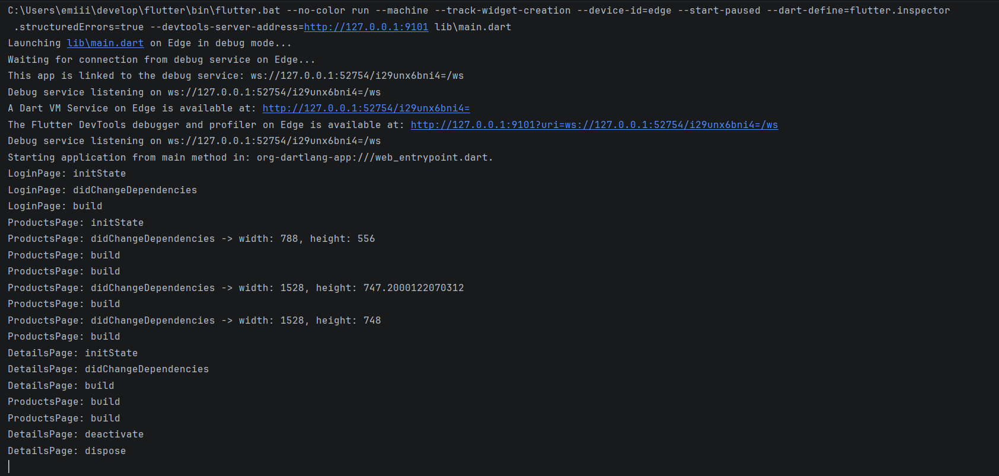
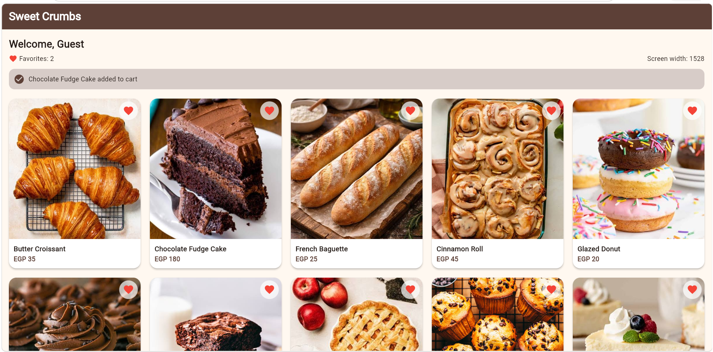

# Sweet Crumbs - Mini Product Catalog

This is my Flutter project for the Navigator and go_router assignment. It's a small bakery app with 3 screens: Login -> Products -> Product Details. I built it first with Navigator, then switched to go_router (the old Navigator code is still in the files, but commented out).

## Screenshots

Debug console with the lifecycle prints:



Products page:



## What the app does

- Login page with a Login button that sends the user "Guest" to the Products page
- Products page shows "Welcome, Guest", a Favorites counter, and the current screen width
- If the screen width is less than 600 it shows a list, otherwise a grid (the number of columns depends on the width)
- Tapping a product opens the Details page with its name and price
- "Add to Cart" goes back to the Products page and shows "<product> added to cart"

## Project structure

```
lib/
  main.dart            -> GoRouter + theme + my answers (in a comment at the top)
  login_page.dart      -> LoginPage
  products_page.dart   -> ProductsPage
  details_page.dart    -> DetailsPage
  products_data.dart   -> the products list
  bakery_widgets.dart  -> list/grid widgets with images
  product_widgets.dart -> the helper file from the assignment
assets/images/         -> product photos
```

## go_router routes

| Route | Page | Parameters |
|---|---|---|
| `/` | LoginPage | none |
| `/products` (name: products) | ProductsPage | query: `?user=Guest` |
| `/details/:name/:price` (name: details) | DetailsPage | path: name and price |

## Part 1: Lifecycle answers

**a) Which methods run when a page opens for the first time?**
`initState`, then `didChangeDependencies`, then `build`.

**b) Which method runs again after I press the heart button?**
Only `build`. `setState` rebuilds the page, but `initState` and `didChangeDependencies` don't run again.

**c) Which methods run when I leave a page and go back?**
The page I leave (DetailsPage) runs `deactivate` and then `dispose`. The page I go back to (ProductsPage) only runs `build`, because with `push` it was still alive under the details page. With `go` (Login -> Products) the login page is replaced, so it also runs `deactivate` and `dispose`.

**d) Which methods run when I resize the browser window, and why?**
`didChangeDependencies` and then `build`, many times. I read the screen size with `MediaQuery.sizeOf(context)` in the page, so the page depends on MediaQuery. When the size changes, Flutter tells the page its dependency changed, so it runs `didChangeDependencies` and then rebuilds.

## Part 4: Short answers

**1) What is the difference between context.go and context.push?**
`context.go` replaces the current stack with the new page, so there is no back button to the old page. `context.push` puts the new page on top, so I can go back.
Example of go: Login -> Products (`context.goNamed('products')`).
Example of push: Products -> Details (`context.push('/details/$name/$price')`).

**2) Why go for Login -> Products and push for Products -> Details?**
After logging in the user shouldn't go back to the login page, so I used `go`. From Products to Details the user should be able to go back, and I also wait (`await`) for the result "... added to cart", so I used `push`.

**3) Path parameter vs query parameter?**
A path parameter is part of the path and is needed to reach the page. Example: `/details/Butter%20Croissant/35`. A query parameter comes after the `?` and is extra info. Example: `/products?user=Guest`.

## How to run

```bash
flutter pub get
flutter run
```

I ran it in the browser because I don't have an emulator.